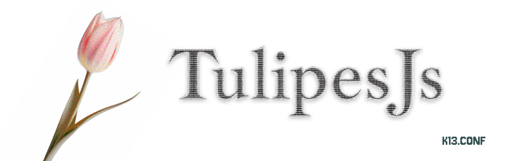

<div align="center">



**The Express framework that refuses to start when something is wrong.**

[](https://www.npmjs.com/package/@tulipes/core)
[](https://www.npmjs.com/package/@tulipes/spec)

</div>

---

This is the Tulipes monorepo — the framework, its spec generator, and the
reference app they are developed against.

| | |
|---|---|
| [`packages/core`](./packages/core) | `@tulipes/core` — the framework and the `tulipes` CLI |
| [`packages/spec`](./packages/spec) | `@tulipes/spec` — OpenAPI 3.1 and Postman from a booted app's routes |
| [`example`](./example) | the reference application: six modules, exercising every contract |

Start with **[packages/core/README.md](./packages/core/README.md)** — that is
the documentation. This file only says where things live.

## Working in here

```sh
corepack enable          # once per machine — activates the pinned yarn 4
yarn install
yarn typecheck           # every public workspace
yarn example             # boot the reference app (needs MongoDB and Redis)
```

The example is not a demo kept alive by hand: CI scaffolds a fresh app with
`tulipes init --preset production` and diffs its `modules/` against `example/modules/`, so the
two cannot drift.

## Quality and support

Default `tulipes init my-api` creates a minimal API without MongoDB or Redis.
Use `--preset production` for the full reference application. Node 24.x is the
supported runtime. Both presets include Vitest tests.

See [Testing](docs/testing.md), [Contributing](CONTRIBUTING.md),
[Security](SECURITY.md), [Support](docs/support.md) and
[Releasing](docs/releasing.md). Publication requires the complete reusable CI
workflow and installs/tests the exact archives that will be uploaded to npm.
The repository remains private, so source, issues and CI require access.

---

<div align="center">
<sub>Built by <b>k13.conf</b></sub>
</div>
